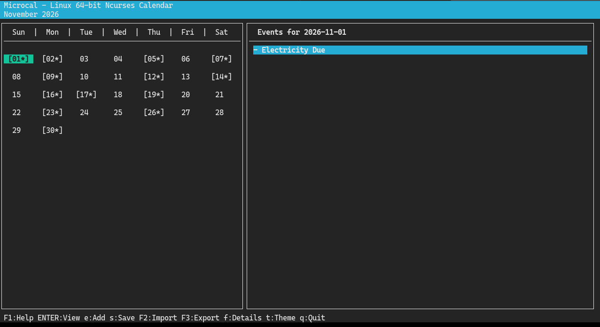

# Microcal

A lightweight, keyboard-driven terminal calendar for Linux built with C and Ncurses. Microcal provides an intuitive monthly grid, event management, theme support, and strict RFC 5545 iCalendar (`.ics`) import and export capabilities.



---

## Features

- **Terminal Grid View:** Clean monthly layout with highlighting for current date, selection cursor, and active event indicators (`[DD*]`).
- **RFC 5545 Standard Compliant:**
  - Strict vanilla `.ics` export with no proprietary vendor junk or tracking attributes.
  - Generates mandatory `UID` and UTC `DTSTAMP` timestamps.
  - Adheres to standard all-day non-inclusive `DTEND` calculations.
  - Multi-line text escaping and unescaping (`\n`).
  - Supports recurring events: `RRULE` with daily, weekly, monthly, and yearly frequencies, `INTERVAL`, `BYDAY` (including ordinals such as `1MO` or `-1FR`), `BYMONTH`, `BYMONTHDAY` (including negative values), `BYSETPOS` (up to 8 values), `UNTIL` and `COUNT`, plus `EXDATE`, `RDATE`, and `RECURRENCE-ID` overrides.
  - Timed events are exported as floating wall-clock time (see [File Format & Standards](#file-format--standards)).
- **Interactive Event Dialogs:** View, inspect, scroll through multi-line descriptions, and delete events directly from the UI.
- **Theming:** Built-in color themes to fit different terminal palettes.
- **Session Persistence:** Automatically remembers and reloads the last used `.ics` file.

---

## Dependencies

- A C99 compiler (`gcc` or `clang`)
- `make`
- `ncurses` development libraries (`libncurses-dev` on Debian/Ubuntu, `ncurses-devel` on Fedora/RHEL/Arch)

---

## Building and Running

Clone or navigate to the source directory and compile:

Just run 'build_release' and it will build via cmake into a .build directory.

---

## Keybindings

| Key | Action |
| :--- | :--- |
| **Arrow Keys** | Navigate calendar days (Left, Right, Up, Down) |
| **Page Up / Page Down** | Switch between previous and next months |
| **Enter** / **v** | View scheduled events and details for the selected day |
| **e** | Add an event on the selected day, with an optional repeat (see [Adding Events](#adding-events)) |
| **s** | Save / export current calendar to `.ics` |
| **F1** | Open Help and Keyguide dialog |
| **F2** | Import an external `.ics` file (events whose UID already exists are replaced) |
| **F3** | Export current calendar to an alternate `.ics` path |
| **t** | Cycle color themes (Default, Ocean, Foreground Pop) |
| **q** | Quit Microcal |

### Day Event View Controls

When viewing events on a specific day (**Enter**):
- **Up / Down**: Select between events on that day
- **d** / **Delete**: Delete the currently selected event (asks for confirmation)
- **Enter** / **Esc** / **q**: Close the event viewer

### Adding Events

Press **e** to add an event on the selected day:
1. Type the event title and press **Enter**.
2. Choose a repeat option with **Left / Right** (or **Up / Down**) and press **Enter**:
   - `< No repeat >`: a single event.
   - `< Repeat on every <weekday> >`: weekly on that weekday.
   - `< Repeat on every <N>th of the month >`: monthly on that day number.
   - `< Repeat on every <N>th <weekday> of the month >`: monthly on the same ordinal weekday (for example the 1st Wednesday). Days 29 to 31 count as the 5th occurrence, and months without a 5th occurrence are skipped.
   - `< Repeat once a year >`: yearly on the same date.
3. For repeating events, a checkbox dialog appears (**Up / Down** to move, **Space** to toggle, **Enter** to confirm):
   - `[ ] Every 2 weeks` (or months or years): when checked, the event repeats every second week (month, year). When unchecked, it repeats every week (month, year).
   - `[ ] Ends on a date`: when unchecked, the event repeats forever. When checked, you enter an end date as `YYYY-MM-DD`.
4. A **Time** checkbox dialog appears. Leave it unchecked for an all-day event. When checked, enter a start time as `HH:MM` (00:00 to 23:59), then an optional end time as `HH:MM` that must be later than the start. Leave the end time blank for no end time.

**Esc** at any step cancels the event. Repeating events are saved in the `.ics` export as standard `RRULE` rules.

---

## File Format & Standards

Microcal produces standard iCalendar files compatible with Google Calendar, Apple Calendar, Thunderbird, and Nextcloud.

```text
BEGIN:VCALENDAR
VERSION:2.0
PRODID:-//Microcal//Ncurses Calendar Linux//EN
CALSCALE:GREGORIAN
BEGIN:VEVENT
UID:microcal-1793567611-1@local
DTSTAMP:20261101T211331Z
SUMMARY:Team Sync
DTSTART;VALUE=DATE:20261115
DTEND;VALUE=DATE:20261116
TRANSP:TRANSPARENT
END:VEVENT
END:VCALENDAR
```

### Timed Events

Each timed event keeps its own zone. An imported event keeps the `TZID` of its `DTSTART` (or `UTC` for a `Z` time), and its recurrence is expanded in that zone, so a weekly 09:00 New York event still shows at 09:00 New York time across daylight-saving changes. Microcal shows the times in your local timezone. Export writes `DTSTART;TZID=<zone>:...`. Floating times stay floating only when the machine's zone cannot be determined; otherwise they are written with this machine's zone. UTC times are written with `Z`. Each zone used by a timed event gets a `VTIMEZONE` component, with `STANDARD` and `DAYLIGHT` observances for the years 1970 to 2037. The window is widened to cover the years of the events, their `EXDATE`/`RDATE` values, and `UNTIL`. Offset changes are found by sampling every day, which is safe because the system zone data never has two changes closer than about a week. For zones whose rule repeats every year (for example New York, London, Sydney), the last observance gets an `RRULE` that continues past the window. The `RRULE` is only written after the zone's last 60 years of real offsets, from the window end onward, are checked against it. Zones with irregular or "Sunday on or after N" rules (for example Casablanca, Cairo, Gaza, and Santiago's April change) keep explicit dates only through the window end, so their later changes are not in the `VTIMEZONE`. The DST conversion unit test is `tests/zone_test.c`. The import/export test suite is `tests/io_test.c`; it covers recurrence EXDATE/RDATE, RECURRENCE-ID overrides, DURATION across DST, all-day events, UID rules, VALARM skipping, line folding, VTIMEZONE output, export round trips, and export failure paths. Run both with `ctest` after a CMake build. Multi-day all-day events are exported with an exclusive `DTEND`, and every day they cover is shown in Microcal.

In the side panel and day view, a timed event shows as `HH:MM` or `HH:MM-HH:MM`, with ` +N day(s)` added when the end falls on a later day. A timed event that runs past midnight is listed on its start day only. The day view lists all-day events first, then timed events by start time. Events with the same start keep their stored order.

### Import Behaviour

- **Replace by UID:** An imported event whose `UID` matches an existing event replaces it. Events absent from the file are kept.
- **Missing UID:** An event without a `UID` gets a stable content-hash UID, so re-importing the same file does not duplicate it.
- **Duplicate UIDs in one file:** Later copies get a `#N` suffix so that no event is lost.
- **Line folding:** Folded lines (RFC 5545 §3.1) are unfolded before parsing. Export folds at 75 octets, never splitting a UTF-8 character.
- **Sub-daily frequencies** (`HOURLY`, `MINUTELY`, `SECONDLY`) are imported as `DAILY`.
- **Durations:** `DURATION` is used when `DTEND` is absent.
- **Alarms:** `VALARM` blocks are skipped, so they cannot overwrite the event's `SUMMARY` or `DESCRIPTION`.
- **Timed events** keep their start and optional end time, together with their zone. A `TZID` is looked up in `/usr/share/zoneinfo`. A `Z` time is kept as UTC. If the zone is unknown or that database is missing, the clock digits are kept as floating time.
- **Property order:** `DTEND`, `RRULE`, `EXDATE`, `RDATE`, and `RECURRENCE-ID` may appear before `DTSTART` in an event. Microcal reads them after the whole event has been parsed, so the result does not depend on their order.
- **DST gaps and overlaps:** A local time that does not exist (spring-forward gap) is taken with the offset from before the change, so `02:30` on the spring-forward day becomes `03:30` daylight time. A local time that happens twice (fall-back overlap) uses the first occurrence, the daylight one.
- **Durations:** A `DURATION` on a zoned start (`Z` or a known `TZID`) adds the exact elapsed time, so the end stays correct across daylight-saving changes. On a floating start it adds wall-clock time, as RFC 5545 specifies.
- **Overrides:** A `RECURRENCE-ID` event is imported under the UID `base#YYYYMMDD`. On export it is written as a standalone event, and the master event gets an `EXDATE` for that day.
- **EXDATE and RDATE** match by date only, after the same conversion as DTSTART. The time part is ignored.
- **RECURRENCE-ID** is read in its own event's zone, which is treated as the master's zone.

**Not supported** (these parts of a rule are ignored): `BYHOUR`, `BYMINUTE`, `BYSECOND`, `BYWEEKNO`, `BYYEARDAY`, `RANGE=THISANDFUTURE`, and `BYSETPOS` values beyond the first 8. `UNTIL` is compared by date only. A `Z` UNTIL is converted into the event's start zone first, then only its date is used.

---

## Small Terminals

- The day event view needs at least 50 columns and 9 lines. Below that it shows "Terminal too small" and keeps working when the window grows again.
- Text prompts and the repeat picker need at least 60 columns and 7 lines.
- **Esc** cancels a text prompt. Previously Esc was entered as text.

---

## License

MIT License. Feel free to modify and distribute.